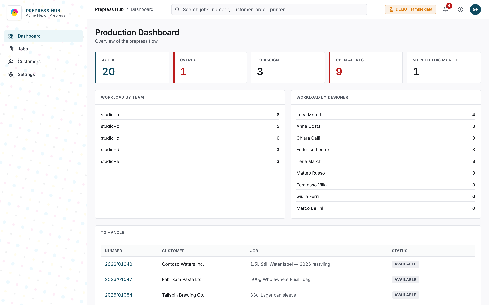
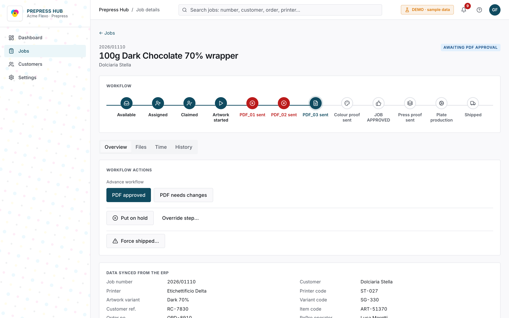
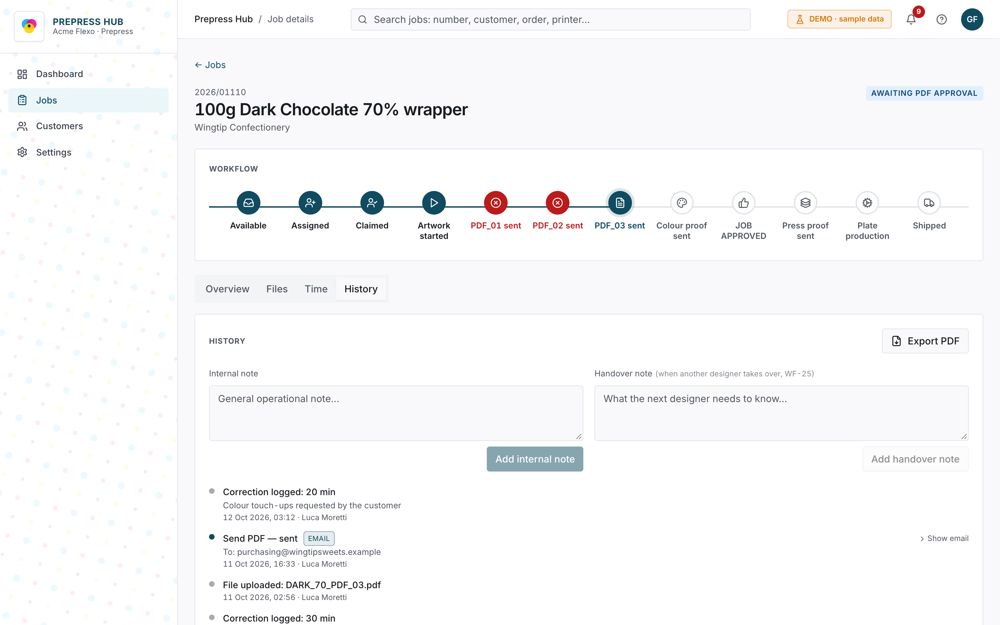
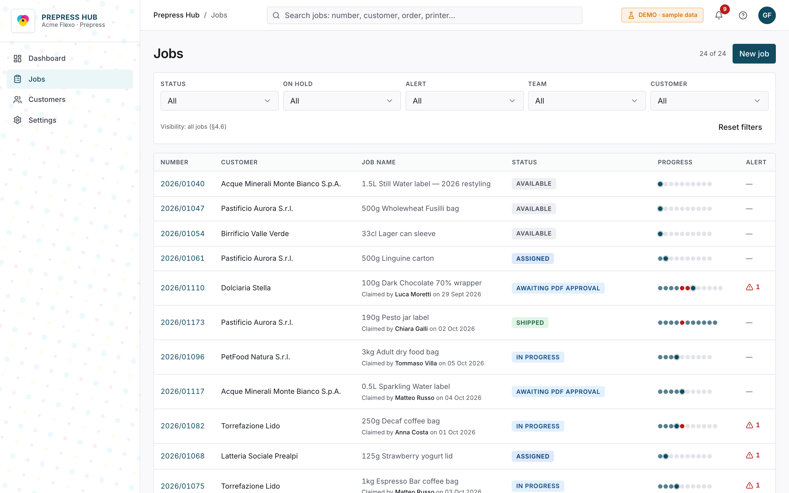

# Prepress Hub — demo

A web app for the **prepress department** of a flexographic printing-plate
manufacturer. It follows every job from the moment it arrives from the ERP until
the plates ship: a state-machine workflow, assignment to designers, customer
approvals by email, files, correction time, alerts and a full audit trail.

> **Demo version.** This is an anonymised copy of a real project I built for a
> client. The company ("Acme Flexo"), people, customers, jobs and email addresses
> are **fictional** (reserved `.example` domains). The Supabase backend is replaced
> by an in-browser database: the whole app runs in your browser and makes no
> network calls.

**Live demo: [prepress-hub-demo.vercel.app](https://prepress-hub-demo.vercel.app)** — pick a
role on the sign-in page (password for every user: `demo`).



| Job detail — metro map and workflow actions | Job history — immutable audit trail |
| --- | --- |
|  |  |



## Try it locally

```bash
npm install
npm run dev        # http://localhost:8080
```

The sign-in page (online or local) has **quick access** buttons for every role (every user's
password is `demo`). In the header, the **DEMO** badge lets you switch user on the
fly and **reset the data**. Changes are kept in your browser (localStorage) until
you reset.

Suggested walkthrough (about 5 minutes):

1. **Giulia Ferri — Production Manager**: dashboard with workload by team and by
   designer, open alerts, jobs waiting to be assigned.
2. Open a job *Awaiting PDF approval* (e.g. "100g Dark Chocolate 70% wrapper"):
   the **metro map** shows the rejected PDFs in red. Click *PDF approved*, then
   *Send colour proof* (email wizard with template, CC and attachment).
3. Try to skip a step: it requires an **override with a mandatory note**, which
   is written to the history.
4. **History** tab: immutable events, archived emails, **PDF export**.
5. Switch to **Luca Moretti — Prepress Designer**: a dashboard focused on their
   own jobs, and actions limited to the jobs they are assigned to.
6. **Settings**: users and roles, prepress teams, mailboxes, email templates.

Tip: a recipient address containing the word `error` simulates a rejection by the
email provider, to show how a failed send is handled and retried.

## Features

- **8-status workflow** (pool → assignment → artwork → PDF approval → colour proof
  → press proof → plate production → shipping), with allowed transitions encoded
  in a single state machine (`src/lib/workflow.ts`) and explicit business rules
  (e.g. no press proof before the colour proof outcome is recorded).
- **Six roles** with different views, actions and data access
  (`src/lib/permissions.ts`), mirrored in the database as Row Level Security
  policies.
- **Metro map** of progress derived from the status (no duplicated state): every
  rejected PDF revision stays visible.
- **Customer emails** from templates with variables, sent from the team mailbox,
  with CC and PDF attachment; permanent archive, failed sends included.
- **Job files** in private storage with signed URLs and 30-day retention after
  shipping.
- **Alerts** computed on the fly: delivery date passed, too much correction time,
  press proof not answered, jobs open for months, first PDF overdue.
- **Holds**, internal notes and handover notes between designers, **append-only
  history** exportable to PDF.

## Architecture

| Layer | Technology |
| --- | --- |
| Frontend | React 18, TypeScript, Vite, Tailwind, shadcn/ui (Radix), Zustand, React Router |
| Original backend | Supabase: Postgres with Row Level Security, Auth, Storage, Edge Functions (Deno), pg_cron |
| Email | `send-email` Edge Function → email provider, server-side archiving |
| Quality | TypeScript in strict mode, ESLint, Vitest + Testing Library (130+ tests) |

Key decisions:

- **The job status is the single source of truth**: metro stop, available
  actions and alerts are all derived, never stored.
- **Security lives in the database, not just the UI**: every UI permission has a
  matching RLS policy, and triggers block disallowed transitions or fields even for
  someone calling the API directly (`supabase/migrations/`).
- **Optimistic updates** with a write queue, and a re-sync from the database if a
  write is rejected.
- **Sensitive operations run server-side only**: sending email, inviting users and
  purging files happen in Edge Functions, with secrets kept out of the browser.

### How the demo runs without a backend

`src/lib/supabase.ts` exports a mock client (`src/lib/demo/mockClient.ts`) instead
of the Supabase client, with the **same interface** the app uses: query builder
(`select/insert/update/upsert/delete`, `eq`, `order`, `single`), auth, storage and
simulated Edge Functions. Everything above that layer works as in the original. The
seed data (`src/lib/demo/seed.ts`) is generated by walking the real workflow, so
each job's history, emails and files are consistent.

The `supabase/` folder contains the original project's SQL migrations (schema,
RLS, triggers, retention) and Edge Functions, anonymised, for reference: the demo
does not run them.

### Glossary

The UI and comments are in English, but identifiers keep the Italian domain
vocabulary of the original project (they match the database schema):

| Code | Meaning |
| --- | --- |
| `commessa` / `commesse` | job / jobs |
| `cliente` / `clienti` | customer / customers |
| `grafico` | prepress designer |
| `stato` | status |
| `prova colore` | colour proof |
| `caduta (macchina)` | press proof |
| `lastre`, `matrice` | printing plates |
| `sospensione` | hold |
| `forzatura` | override (skipping a step) |
| `evento`, `storico` | event, history |
| `presa in carico` | claiming a job |
| `gruppo prestampa` | prepress team |
| `correzione` | correction (time logged) |

## Scripts

```bash
npm run dev         # development server
npm run build       # production build (dist/, static hosting e.g. Vercel)
npm test            # tests
npm run typecheck   # type check
npm run lint        # lint
```
